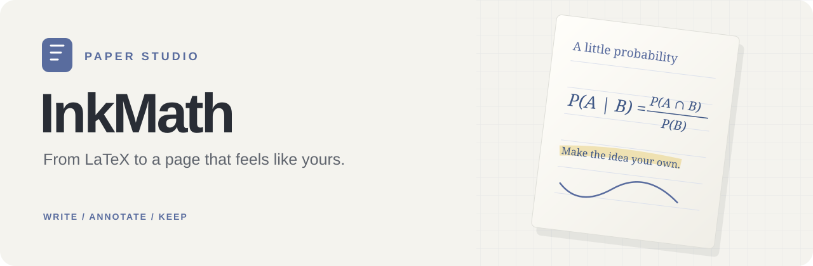
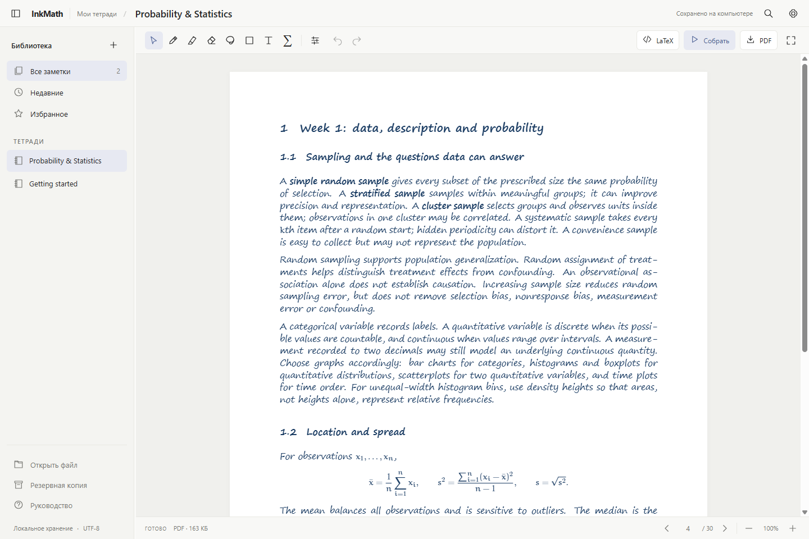
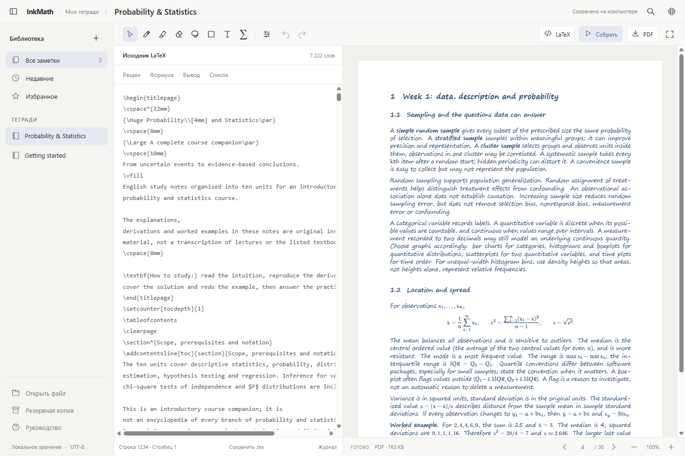

<p align="center"></p>

<p align="center">
  <a href="https://github.com/Smrbruh/InkMath/actions/workflows/ci.yml"></a>
  
  <a href="LICENSE"></a>
</p>

<p align="center"><strong>A quiet Windows notebook for serious mathematics.</strong><br>Write LaTeX. Make handwritten-style pages. Annotate them. Take your PDF anywhere.</p>
<p align="center"><a href="https://github.com/Smrbruh/InkMath/releases/latest">Download</a> · <a href="docs/GETTING_STARTED.md">Getting started</a> · <a href="docs/DEVELOPMENT.md">Build from source</a> · <a href="README.ru.md">Русский</a></p>



## A notebook, with the precision of LaTeX

InkMath brings a source editor, a real TeX compiler and a drawing surface into one local workspace. The page stays at the centre: a restrained toolbar, a notebook library and soft paper colours leave room for the work.

| Make the page                   | Make it yours                     | Keep your work                 |
| ------------------------------- | --------------------------------- | ------------------------------ |
| LaTeX → PDF with Tectonic       | Pen, highlighter and text         | Local autosave                 |
| Handwritten-style body fonts    | Lasso, move and stroke eraser     | PDF with vector annotations    |
| Blank, ruled or grid paper      | Rectangles, undo and redo         | LaTeX source export            |
| Russian and extended Cyrillic   | Four ink colours                  | Full `.inkmath` library backup |
| Live formula preview with KaTeX | Focus mode and adjustable sidebar | No account required            |

**Mathematics remains typeset mathematics.** Handwritten-style fonts apply to body text; this is not handwriting recognition or an imitation of your personal handwriting. Extended Cyrillic characters missing from a selected font use a system-font fallback.

## Start in minutes

Download the portable Windows x64 ZIP from [Releases](https://github.com/Smrbruh/InkMath/releases), extract the **whole folder**, and open `InkMath.exe`. Windows may show a warning because the application is not code-signed.

1. Open the included notebook or create a new one.
2. Open **LaTeX**, add your text and equations, then press **Ctrl+Enter**.
3. Draw or type on the rendered page and export **PDF**.

The first compilation needs internet access to fetch TeX packages. Already cached packages can be reused offline. A 30-page English probability and statistics study companion is included as a working example, with editable source.

### Build it yourself

On Windows x64 with **Node.js 24+** and Git:

```powershell
git clone https://github.com/Smrbruh/InkMath.git
cd InkMath
npm ci
npm run setup
npm start
```

`setup` downloads the pinned official Tectonic build and verifies both the archive and executable using SHA-256. To create the portable application, run `npm run package`; the result is in `dist/InkMath-win32-x64`.

## Designed to stay local

<details>
<summary>See the LaTeX editor beside the rendered page</summary>



</details>

Notes are stored in `%APPDATA%\InkMath\library.json`. There is no InkMath account, cloud sync or analytics service. The compiler downloads TeX resources as needed; see [Privacy](docs/PRIVACY.md) for the network and storage details. Keep regular library backups, especially before upgrading.

## Current boundaries

- Windows x64 only; the interface currently uses Russian. English and Cyrillic document content are supported.
- Handwriting recognition, nested folders, collaboration and cloud sync are not implemented.
- Import accepts a single `.tex` document or an `.inkmath` backup. External project assets and arbitrary PDF import are not supported.
- Drawing is tested with a mouse. Pressure handling is basic; dedicated stylus hardware has not been validated.
- Annotations are positioned on pages. Changing the source layout can move the content underneath them.

See the [roadmap](docs/ROADMAP.md) for proposed work, not delivery promises.

## Contribute

Bug reports, clear reproduction examples, accessibility improvements and documentation corrections are welcome. Start with [CONTRIBUTING](CONTRIBUTING.md) and the [architecture notes](docs/ARCHITECTURE.md).

If InkMath helps your study sessions, a star helps other people find it. Useful feedback is just as welcome.

## Credits & license

InkMath is MIT licensed. Built with Electron, Tectonic, PDF.js, pdf-lib and KaTeX; see [third-party notices](THIRD_PARTY_NOTICES.md). Windows fonts are used from the system and are not distributed as font files.
