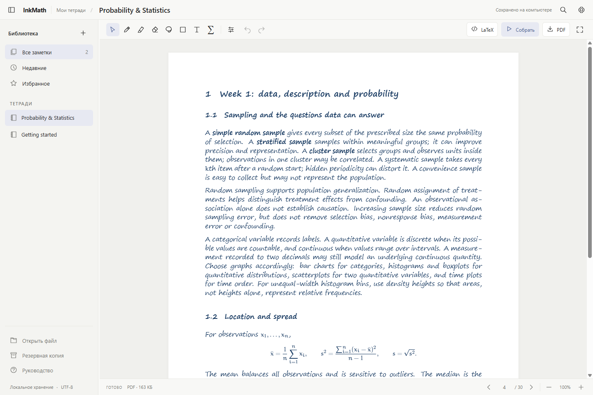

# InkMath · Paper Studio

**LaTeX → страницы с рукописным стилем → пометки → PDF.** Отдельное приложение для Windows, в котором тетрадь остаётся в центре внимания.

[English](README.md) · [Скачать](https://github.com/Smrbruh/InkMath/releases/latest) · [Документация](docs/GETTING_STARTED.md)



## Возможности

- Настоящая компиляция LaTeX через Tectonic и просмотр PDF.
- Рукописные шрифты для текста, математическая вёрстка для формул.
- Русский и расширенная кириллица, включая казахские буквы. Для недостающих символов используется резервный системный шрифт.
- Перо, маркер, ластик штрихов, лассо, перемещение, прямоугольники и текст.
- Белая, линованная и клетчатая бумага; четыре цвета чернил.
- Библиотека, поиск, избранное, автосохранение и режим фокуса.
- PDF с пометками, исходник `.tex` и резервная копия `.inkmath`.
- Пример: редактируемый конспект по вероятности и статистике на английском, 30 страниц.

## Запуск

Скачайте ZIP для Windows x64 из [Releases](https://github.com/Smrbruh/InkMath/releases), распакуйте **всю папку** и запустите `InkMath.exe`. Приложение не имеет цифровой подписи, поэтому Windows может показать предупреждение.

Откройте LaTeX, введите текст и формулы, нажмите **Ctrl+Enter**. После сборки можно рисовать на странице и экспортировать PDF. Первая сборка загружает пакеты TeX из интернета; сохранённые пакеты используются повторно.

## Из исходников

Нужны Windows x64, Git и Node.js 24+:

```powershell
git clone https://github.com/Smrbruh/InkMath.git
cd InkMath
npm ci
npm run setup
npm start
```

`npm run package` создаёт переносимую сборку в `dist/InkMath-win32-x64`. Компилятор устанавливается из официального выпуска Tectonic с проверкой SHA-256.

## Ваши данные

Тетради хранятся локально в `%APPDATA%\InkMath\library.json`. Учётная запись не нужна, аналитики и облачной синхронизации нет. Регулярно сохраняйте резервную копию библиотеки. Подробнее: [Privacy](docs/PRIVACY.md).

Сейчас интерфейс русский. Распознавания рукописного ввода, вложенных папок и импорта произвольного PDF пока нет. Импорт LaTeX рассчитан на один файл; внешние изображения и файлы проекта автоматически не подхватываются. После изменения вёрстки исходника проверьте расположение пометок.

[Планы](docs/ROADMAP.md) · [Участие в разработке](CONTRIBUTING.md) · [Лицензия MIT](LICENSE)
