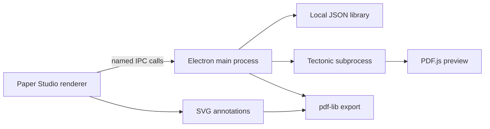

# Architecture

InkMath is an Electron application with a vanilla JavaScript renderer. There is no application backend service.

| File                 | Responsibility                                               |
| -------------------- | ------------------------------------------------------------ |
| `main.cjs`           | Window, filesystem operations, compilation and IPC handlers  |
| `preload.cjs`        | Explicit renderer bridge with context isolation              |
| `renderer.js`        | Library, source editor, compilation state and PDF lifecycle  |
| `studio.js`          | Drawing, selection, history, popovers and workspace controls |
| `latex.cjs`          | Document wrapper, appearance settings and Unicode fallback   |
| `annotations.cjs`    | Convert page annotations into vector PDF content             |
| `styles.css`         | Design tokens, layout and component styling                  |
| `font-coverage.json` | Supported glyph information for selected Windows fonts       |

## Data and rendering

A library has a version, active note ID and notes. Each note stores its ID, title, LaTeX source, normalised settings, timestamps, favourite flag and annotations keyed by page number. Library saves are queued and written through a temporary file before replacement.

Compilation creates a temporary directory, writes the generated TeX and runs Tectonic in untrusted mode with a five-minute timeout. PDF bytes return to the renderer for PDF.js to display. The main process retains the latest PDF for export. Temporary compilation files are removed when the job ends.

Annotations use a page-relative coordinate system. The SVG overlay handles editing; pdf-lib maps those coordinates into the exported PDF. Unicode text annotations embed a system font. Source changes do not reflow annotation positions.

PDF.js loading tasks own document cleanup. Cancel active rendering before destroying a loading task or switching documents. This matters when rebuilding or rapidly navigating between notes.

## Trust boundaries

The renderer has no Node.js integration. Filesystem actions go through the preload bridge. New windows and unexpected navigation are blocked. Imported library fields are constrained before saving. These controls reduce exposure; they do not constitute a security audit.
